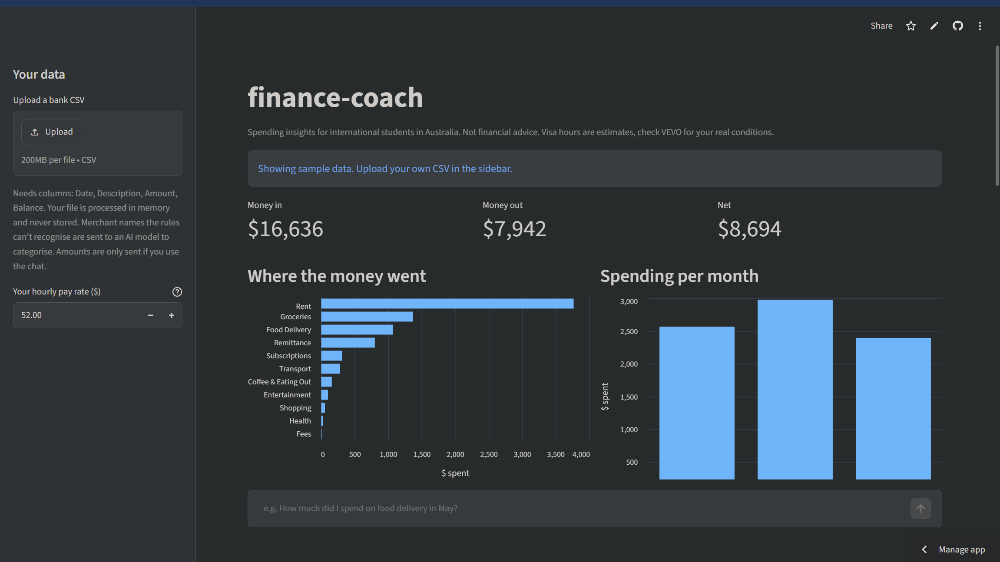

# finance-coach


An AI-powered budgeting dashboard built for **international students in Australia**.

Most budgeting apps assume you're a local working adult. International students deal with stuff those apps ignore: a 48-hour fortnightly work limit on their visa, money coming in from family overseas, money going back home, and casual jobs with irregular pay. finance-coach is built around those problems.

**🔗 Live demo: [finance-coach-vir.streamlit.app](https://finance-coach-vir.streamlit.app/)**



---

## Features

- **Upload a bank CSV** and get a full breakdown. Your file is processed in memory and never stored.
- **Smart categorisation.** Regex rules handle the common merchants, then an LLM handles the messy ones (`SQ *`, `SMP*`, `PAYPAL *` style names). Rules alone cover 96% of the sample data, rules + LLM cover 100%.
- **Visa work-hours tracker.** Estimates hours worked from pay deposits and checks every rolling 2-week window against the 48-hour limit (student visa condition 8105). Course breaks are skipped since there's no limit then.
- **Subscription detector.** Finds charges that repeat monthly at about the same price, with the yearly cost and the next expected charge date.
- **Unusual spending.** Flags transactions that are way above what you normally spend in that category.
- **"Ask about your spending" chat.** Ask questions in plain English, like "how much did I spend on food delivery in May?"
- **AUD → INR exchange rate trend.** Latest rate, 90-day average, high and low, plus a chart.

### Example: visa hours check

```
  29 Apr - 06 May    40.0 hrs   OK
  06 May - 13 May    50.0 hrs   BREACH
  13 May - 20 May    52.0 hrs   BREACH
  20 May - 27 May    46.0 hrs   WARNING
  27 May - 03 Jun    42.0 hrs   OK
```

One heavy week shows up as a breach in **both** windows it's part of. A tracker that only checked fixed pay fortnights would miss one of them.

---

## How it works

```
bank CSV
   │
   ▼
data_loader.py        load + validate + parse AU dates
   │
   ▼
categorise.py         regex rules (fast, free, predictable)
   │
   ▼
llm_categorise.py     LLM fallback for whatever the rules missed
   │
   ├──► visa_tracker.py     rolling 2-week work hours check
   ├──► subscriptions.py    recurring monthly charges
   ├──► anomalies.py        unusual spending per category
   └──► ask.py              chat over pre-computed totals

fx.py                 AUD → INR rates (separate, from the Frankfurter API)
app.py                Streamlit dashboard that ties it all together
```

### Design decisions

- **Rules before the LLM.** Regex is free, instant and predictable, so the LLM only sees the few transactions the rules can't handle.
- **Don't trust raw LLM output.** A category from the model is only accepted if it exactly matches one of the allowed categories. Anything else stays `Uncategorised`.
- **pandas does the maths, the LLM does the language.** LLMs are unreliable at adding up long lists of numbers, so the chat gets tables of totals already worked out by pandas and only has to read them.
- **Rolling windows, not pay periods.** The visa limit applies to any 2-week period, so every pair of back-to-back weeks gets checked. A skipped week (no pay) isn't wrongly added into the next window.
- **Median + MAD for anomalies, not mean + std dev.** One big outlier drags the mean and std dev up and partly hides itself. Median and MAD barely move. A transaction also has to be at least $20 above normal, so a $18 burger next to $5 coffees doesn't get flagged.
- **Subscriptions need 3 things:** 3+ charges, a steady price (within 20%, so small price rises still count) and a roughly monthly gap. That rules out weekly rent and groceries.
- **Nothing gets stored.** Uploaded files are only processed in memory, and the web app keeps its LLM cache per visitor, in memory only.
- **Tests never touch the internet.** The LLM tests use a fake client, and the exchange rate code keeps fetching separate from the maths, so all 32 tests run offline in about a second. GitHub Actions runs them on every push.
- **`dayfirst=True`.** pandas assumes US date format by default, which silently turns 01/04 into January 4th instead of April 1st.

---

## Tech stack

| Area | Tools |
|---|---|
| Language | Python 3.13 |
| Data | pandas |
| Dashboard | Streamlit, Altair |
| LLM | Groq API (`openai/gpt-oss-20b`) |
| Exchange rates | Frankfurter API, httpx |
| Testing / CI | pytest, GitHub Actions |
| Deployment | Streamlit Community Cloud |

---

## Getting started

### 1. Clone and set up

```bash
git clone https://github.com/virgohil16/finance-coach.git
cd finance-coach
python -m venv venv
```

Activate the virtual environment:

```powershell
# Windows (PowerShell)
venv\Scripts\Activate.ps1
```

```bash
# Mac / Linux
source venv/bin/activate
```

Install dependencies:

```bash
pip install -r requirements.txt
```

### 2. Add your API key

Get a free key from [console.groq.com](https://console.groq.com), then copy the example file:

```powershell
copy .env.example .env    # Windows
```

```bash
cp .env.example .env      # Mac / Linux
```

Open `.env` and replace the placeholder with your key. `.env` is gitignored, so it never gets committed.

### 3. Run it

Always run from the project root:

```bash
streamlit run app.py             # the dashboard

python -m src.generate_sample    # rebuild the sample data
python -m src.categorise         # rule-based categories + coverage
python -m src.llm_categorise     # LLM fallback for the rest
python -m src.visa_tracker       # visa work hours check
python -m src.subscriptions      # recurring charges
python -m src.anomalies          # unusual spending
python -m src.ask                # chat demo question
python -m src.fx                 # AUD -> INR rates

python -m pytest -v              # run all tests
```

---

## Project structure

```
finance-coach/
├── app.py                        # Streamlit dashboard
├── .github/workflows/tests.yml   # runs the tests on every push
├── data/
│   └── sample_transactions.csv   # synthetic data (safe to commit)
├── docs/
│   └── dashboard.png             # README screenshot
├── src/
│   ├── config.py                 # pay rates, visa limit, course breaks, LLM model
│   ├── data_loader.py            # load + validate CSVs
│   ├── categorise.py             # regex categoriser
│   ├── llm_categorise.py         # LLM fallback + cache
│   ├── visa_tracker.py           # rolling 2-week hours check
│   ├── subscriptions.py          # recurring monthly charges
│   ├── anomalies.py              # unusual spending (median + MAD)
│   ├── ask.py                    # chat over pre-computed totals
│   ├── fx.py                     # AUD -> INR exchange rates
│   └── generate_sample.py        # builds realistic sample data
├── tests/                        # 32 tests, all offline
├── .env.example
└── requirements.txt
```

---

## Roadmap

- [x] Validated CSV loader with Australian date handling
- [x] Rule-based categorisation + LLM fallback (96% → 100% coverage)
- [x] Visa work-hours tracker (rolling 2-week windows, condition 8105)
- [x] Streamlit dashboard + live demo
- [x] Subscription detector
- [x] Unusual spending detection
- [x] "Ask about your spending" chat
- [x] AUD → INR exchange rate trend
- [x] Tests on every push with GitHub Actions
- [ ] Support each big bank's CSV format directly (CBA, NAB, ANZ, Westpac)
- [ ] Bank PDF statement parsing
- [ ] Beta test with international students at Monash

---

## Privacy

- The sample data is **completely synthetic**. No real bank data is in this repo.
- Uploaded files are processed in memory and **never stored**.
- Merchant names the rules can't recognise are sent to the LLM to categorise. Amounts are not.
- If you use the chat, a summary of your spending (totals, subscriptions and unusual transactions) is sent to the LLM to answer your question.
- Real CSVs, PDFs, the local LLM cache and `.env` are all gitignored.

## Disclaimer

finance-coach shows insights about your own spending. It is **not financial advice**, and the exchange rate section is information only, not a recommendation on when to send money. Visa work hours are **estimates** based on pay deposits. Always check your actual visa conditions on [VEVO](https://immi.homeaffairs.gov.au/visas/already-have-a-visa/check-visa-details-and-conditions) or with the Department of Home Affairs.

---

## Author

**Vir Gohil**, Bachelor of Computer Science (AI & Data Science), Monash University

[GitHub](https://github.com/virgohil16)
